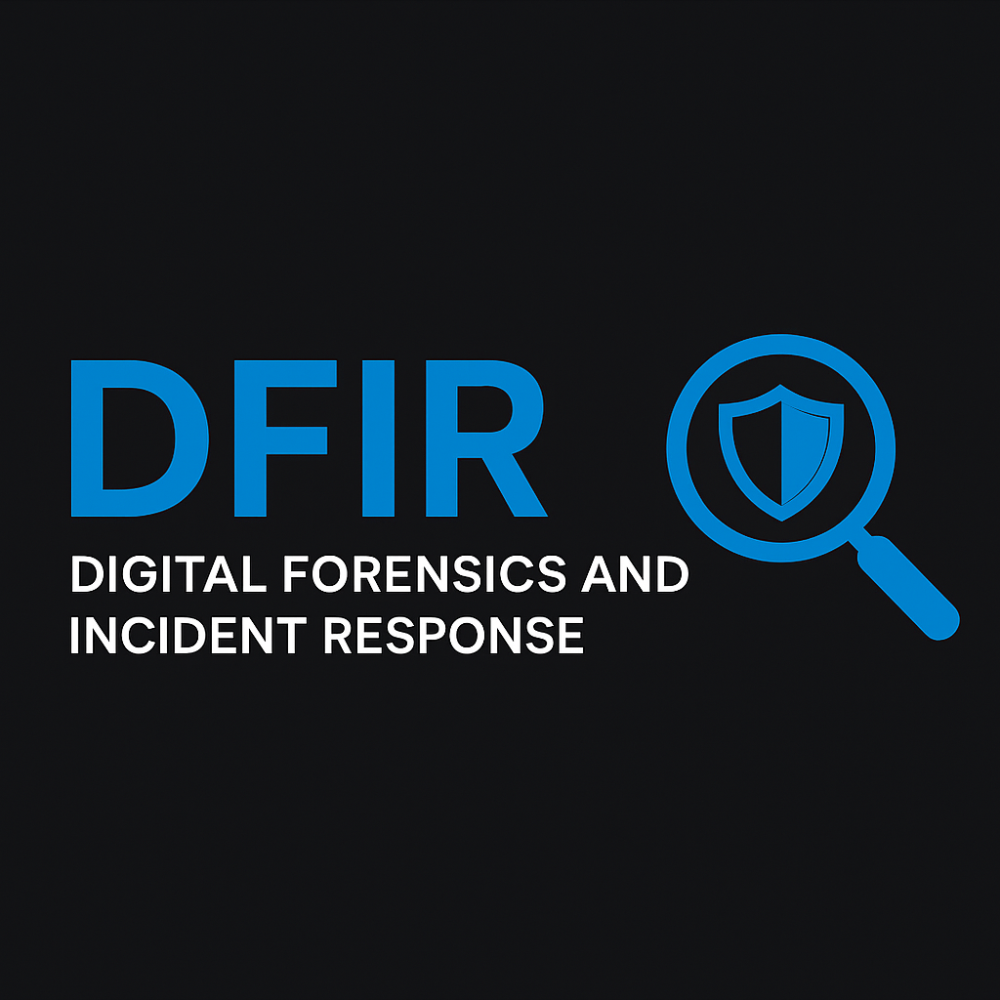

  

<h1 align="center">🛡 Cybersecurity & DFIR Projects</h1>

  
  
  

A structured collection of hands-on cybersecurity projects focusing on <b>Digital Forensics</b>, <b>Log Analysis</b>, and <b>Incident Response</b>. This repository documents my workflow for simulating attacks, detecting artifacts, and investigating security incidents.

---

## 📌 Overview
The goal of this repository is to demonstrate practical competency in **Blue Team operations**. Each project simulates a real-world attack scenario followed by a full forensic investigation.

**Core Competencies Demonstrated:**
- 🐧 **Linux Security:** Syslog analysis, user tracking, and permission auditing.
- 🔎 **Forensics:** Timeline reconstruction and artifact correlation.
- 🛡 **Frameworks:** Mapping attacks to the **MITRE ATT&CK** matrix.
- 📝 **Reporting:** documenting findings with an Incident Response (IR) mindset.

---

## 📂 Project Index

### 1️⃣ *Linux Attack Simulation & Log Analysis*
**Status:** ✔ Completed

*Scenario:* A compromised Linux server involving brute-force entry and privilege escalation.

* **🔴 Attack Phase (Red Team):**
    - SSH Brute-force (`Hydra`)
    - Privilege Escalation via Sudo misuse
    - Persistence (Backdoor user creation)
    - Data Exfiltration simulation

* **🔵 Defense Phase (Blue Team):**
    - Analyzed `/var/log/auth.log` and `/var/log/syslog`
    - Identified attacker IP and timestamps
    - Reconstructed the attack lifecycle (Kill Chain)
    - Mapped TTPs to **MITRE ATT&CK** (T1110, T1078, T1098)

---

## 🧰 Tools & Technologies

| Category | Tools & Skills |
|---------|-------|
| *Operating Systems* | Ubuntu Server, Windows 10/11 |
| *Log Analysis* | `syslog`, `auth.log`, Windows Event Viewer, `grep/awk` |
| *Attack Tools* | Hydra, Nmap, SSH |
| *Methodologies* | MITRE ATT&CK, Cyber Kill Chain |
| *Scripting* | Bash (Log parsing & automation) |

---

## 📬 Contact
Open to collaboration on DFIR projects and security research.

- *📧 Email:* [saifcyb@gmail.com](mailto:saifcyb@gmail.com)
- *🔗 LinkedIn:* [Mohammed Saif Ul Islam](https://www.linkedin.com/in/mohammed-saif-ul-islam-85a68639a/)
